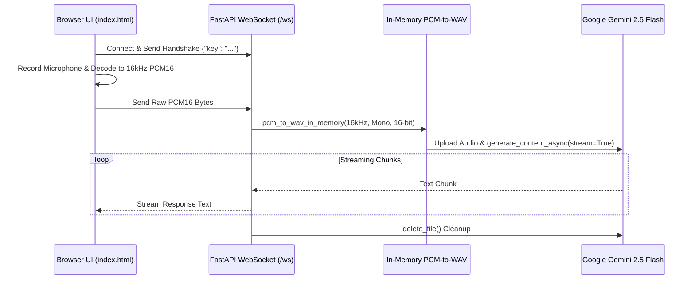

# 🎙️ Gemini Live — Real-Time Browser-to-FastAPI Audio Streaming


A real-time browser audio recording and streaming application built with **FastAPI**, **WebSockets**, **Web Audio API**, and **Google Gemini (`gemini-2.5-flash`)**. It captures microphone audio in the browser, downsamples to 16kHz 16-bit mono PCM, converts to WAV in memory on the server, and streams Gemini transcriptions and answers back over the WebSocket.

---

## 📐 Architecture



---

## 📁 Project Structure

```text
websocket-pcm-audio-streamer/
├── main.py                # Primary entry point starting Uvicorn on port 8000
├── feature_websocket.py   # FastAPI app, GET / index route, PCM-to-WAV helper, and /ws endpoint
├── index.html             # Browser client with MediaRecorder and 16kHz AudioContext decoder
├── .env.example           # Environment variable template
├── requirements.txt       # Python dependencies
└── README.md              # Project documentation
```

---

## ⚙️ Environment Variables

| Variable | Required | Default | Description |
| :--- | :---: | :---: | :--- |
| `GEMINI_API_KEY` | Optional* | — | Server-side fallback Gemini API key (*can also be entered in the browser prompt) |
| `PORT` | No | `8000` | Port for the FastAPI Uvicorn server |

---

## 🚀 Quickstart

```bash
git clone https://github.com/shubhamv3129/websocket-pcm-audio-streamer.git
   cd websocket-pcm-audio-streamer
python3 -m venv .venv
source .venv/bin/activate
pip install -r requirements.txt

cp .env.example .env
# Optionally set GEMINI_API_KEY in .env

python3 main.py
```

Open `http://localhost:8000` in Chrome, click **Connect**, and click **Record** to stream audio to Gemini.
